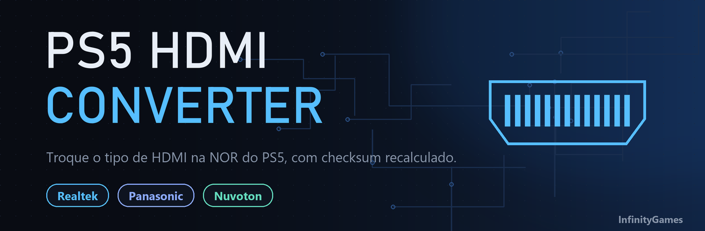
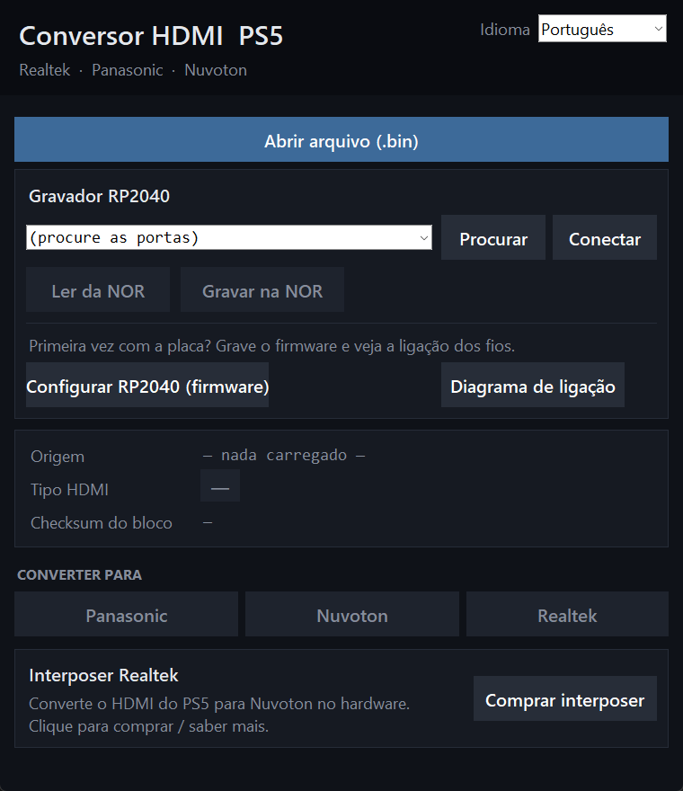
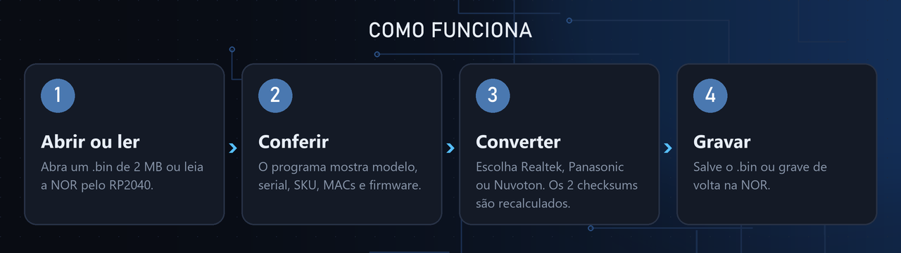
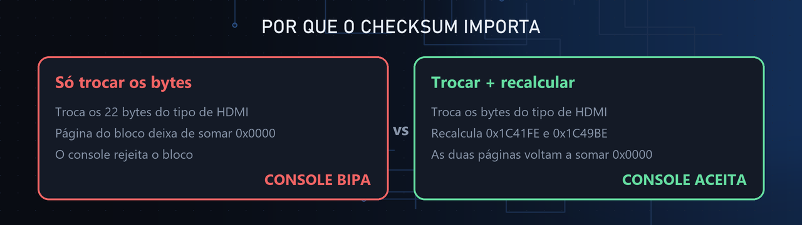
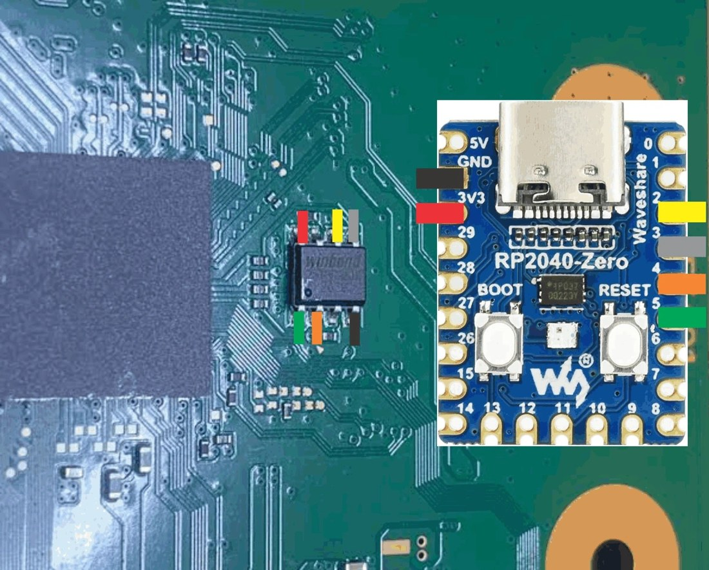

**Utilitário de bancada para trocar o tipo de HDMI gravado na NOR do PS5,
com o checksum do bloco recalculado.**

## Visão geral

O PS5 guarda na NOR o tipo de chip HDMI da placa: **Realtek**, **Panasonic** ou
**Nuvoton**. Quando o chip físico (ou o interposer instalado) não casa com o que
está gravado, o console não dá vídeo. Este programa troca o tipo gravado e
**recalcula o checksum** do bloco, sem tocar em mais nada da NOR.

## Recursos

| | |
|---|---|
| **Conversão entre 3 tipos** | Realtek, Panasonic e Nuvoton, nos dois sentidos |
| **Checksum recalculado** | As duas páginas do bloco voltam a somar `0x0000` |
| **Leitura e gravação da NOR** | Direto por um RP2040 (Pico ou RP2040-Zero), ou abra e salve `.bin` |
| **Valida o dump** | Só aceita NOR de PS5 (W25Q16, 2 MB) |
| **Mostra a identidade da placa** | Modelo, serial, SKU, MACs, SOCUID, firmware e slot ativo |
| **Não mexe na identidade** | MAC, serial, SOCUID e WiFi ficam intactos; só o setor do HDMI muda |
| **Prepara o RP2040** | Grava o firmware (BOOTSEL) e mostra o diagrama de ligação |
| **Trilíngue** | Português, English e Español, trocando na hora |

## Como funciona

1. **Abrir ou ler.** Abra um `.bin` de 2 MB ou leia o chip pelo RP2040.
2. **Conferir.** Veja a identidade da placa e confirme que leu o dump certo.
3. **Converter.** O tipo escolhido **tem que casar com o hardware**: o CI físico da placa ou o interposer instalado.
4. **Gravar.** Salve o `.bin` ou grave de volta na NOR.

## Por que o checksum importa

O bloco HDMI (`0x1C4000` a `0x1C49D0`) tem duas páginas, e cada uma precisa somar
`0x0000` em words de 16 bits. Os words de checksum ficam em `0x1C41FE` e
`0x1C49BE`. Trocar apenas os bytes do tipo deixa as páginas inconsistentes, e o
console rejeita o bloco e bipa. O programa recalcula os dois automaticamente.

## Ligação do RP2040

Para ler e gravar a NOR direto na placa, ligue o RP2040-Zero ao chip como no
diagrama. O mesmo diagrama está dentro do programa, no botão
**Diagrama de ligação**.

## Download

1. Abra a aba **[Releases](../../releases/latest)** e baixe `Conversor_HDMI_PS5.exe`.
2. Execute. Não precisa instalar.

## 🌐 Three languages

**English:** bench tool that converts the HDMI type stored in the PS5 NOR
between Realtek, Panasonic and Nuvoton, recalculating the block checksum so the
console does not beep. Reads and writes the NOR through an RP2040. Download the
exe from [Releases](../../releases/latest).

**Español:** herramienta de banco que convierte el tipo de HDMI guardado en la
NOR de la PS5 entre Realtek, Panasonic y Nuvoton, recalculando el checksum del
bloque para que la consola no pite. Lee y graba la NOR mediante un RP2040. Descarga
el exe en [Releases](../../releases/latest).

## Interposer Realtek

Converte o HDMI do PS5 para Nuvoton direto no hardware.
**[Onde comprar o Interposer Realtek](https://infinitygames.com.br/realtek/)**

## Créditos

- **Estudos do offset de HDMI do PS5:** **TXD Games** e **Thiago Max**.
- **Software e finalização do offset:** **Felipe Calmon**, InfinityGames.

## Aviso

Ferramenta de bancada, para técnicos. Use por sua conta e risco. O tipo de HDMI
gravado precisa corresponder ao CI físico (ou ao interposer) da placa, senão o
console não dá vídeo.

---

© 2026 Felipe Calmon, InfinityGames. Todos os direitos reservados.

